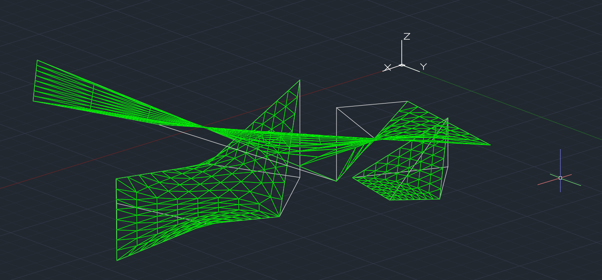

# MiniSurf

以 Python 3.12、pywin32、NumPy、gmpy2、SciPy 與 AutoCAD 2027，從封閉 3D 邊界建立近似 minimal surface，輸出到獨立圖層的三角形 `3DFACE`。



## 安裝與使用

首次安裝，在專案目錄執行：

```powershell
uv venv --seed
.\.venv\Scripts\Activate.ps1
python -m pip install -r requirements.txt
python main.py
```

`uv venv` 會讀取 `.python-version`；`--seed` 會一併安裝 pip。日常執行不需要 uv，也不必啟用虛擬環境：

```powershell
python main.py
```

先開啟 AutoCAD 2027 並切換到目標圖檔。Python 啟動後，在 AutoCAD 選取 ModelSpace 中的多條 LINE／ARC，或單一封閉 3DPOLY／PLINE，按 Enter。選取的線段可不依順序、方向不限，但必須構成一個封閉環。完成後會建立 `MINISURF_<id>` 圖層；來源物件不會修改。輸出為一組三角面片，單次 Undo 可撤回生成操作。

只連接已開啟的 AutoCAD，不會自動啟動或儲存使用者圖檔。多個 AutoCAD 程序同時執行時，請保留單一程序，避免 COM 連到其他實例。

## AutoLISP 指令

```powershell
python main.py --install-lisp
```

這個步驟只會產生 LISP 檔案，**不會自動在 AutoCAD 載入 `minisurf` 指令**。請繼續完成下面的 `APPLOAD` 步驟。

1. 在 AutoCAD 執行 `APPLOAD`，載入產生的 `lisp/minisurf.lsp`。依 AutoCAD 的可信任位置設定允許載入此檔案。
2. 指令列出現 `MiniSurf loaded. Command: minisurf` 後，執行 `minisurf`。
3. 選取 LINE／ARC，或一個封閉的 3DPOLY／PLINE，按 Enter。
4. Python 在背景求解，完成或錯誤訊息會顯示在 AutoCAD 指令列，詳細資訊見 `reports/`。

產生的 LISP 綁定本專案的絕對路徑及 `.venv` 的 Python；搬移專案後請重新產生並載入。中文路徑需要 AutoCAD 的 `LISPSYS=1` 或 `2`；修改後需重新啟動 AutoCAD。LISP 會把選取物件的 handle 存入系統暫存檔，再傳給 Python，並綁定啟動時的圖檔名稱；執行完成前請保持該圖檔開啟，避免重新命名。

## 求解與限制

- v1.0 僅支援單一、封閉、無自交，且 XY 投影為簡單多邊形的邊界。曲面必須能表示為 `z=f(x,y)`；垂直邊、洞、多重封閉環、自接觸及擬合／樣條 polyline 會回報錯誤。
- 先在 XY 平面耳切三角化，再以共享邊中點細分。內部 XY 固定，SciPy L-BFGS-B 使用解析 Z 梯度最小化所有三角形的總 3D 面積。邊界及新增邊界中點的 XYZ 始終固定。
- gmpy2 用於接近共線時的精確方向判斷；面積及最佳化使用 NumPy／SciPy 的雙精度浮點數。
- ARC 與 PLINE bulge 會依指定角度取樣為折線，並由 OCS 轉為 WCS。最小化的是這個折線邊界的離散曲面；不是精確的連續 Plateau 解。
- `--bbox` 必須包含整條固定邊界。固定 XY 及三角形內的線性插值確保整個曲面留在指定長方體內，Z 範圍交由最佳化器施加。
- 只在最佳化器成功、正規化 projected gradient 不超過 `gtol`，且面積沒有增加時輸出到 AutoCAD；未收斂會保留報告與候選網格供診斷。
- 細分級別為 1–6，最多 250,000 個三角形。細長多邊形或過密曲線可能降低網格品質與收斂速度。

## 參數與離線範例

```powershell
# 細分級數、圓弧最大取樣角度、端點接合容差（圖面單位）
.\.venv\Scripts\python.exe main.py --levels 4 --arc-step 5 --tolerance 1e-7

# Bounding Box：xmin ymin zmin xmax ymax zmax
.\.venv\Scripts\python.exe main.py --bbox 0 0 0 10 10 5

# 不連接 AutoCAD，從依邊界順序排列的 XYZ JSON 求解
.\.venv\Scripts\python.exe main.py --boundary-json examples/saddle.json

# 控制迭代與一階收斂容差
.\.venv\Scripts\python.exe main.py --maxiter 4000 --gtol 1e-6
```

`--levels` 每增加一級，三角形數約為四倍。可比較不同級別的面積，觀察網格細化敏感度。

每次執行在 `reports/` 產生 JSON 報告及成功求解後的 NPZ 網格。報告包含初始／最終面積、面積下降量、迭代次數、最佳化器訊息、正規化一階最優性、固定邊界誤差、圖層與錯誤資訊。`boundary_error_max=0` 表示相對重建／取樣後邊界的誤差；端點在容差內接合可能產生微小位移。`discretization_error=null` 表示未估計相對連續曲面的誤差，不應解讀為零。

## 驗證

```powershell
# 開發／測試依賴（已包含執行所需依賴）
.\.venv\Scripts\python.exe -m pip install -r requirements-dev.txt
.\.venv\Scripts\python.exe -m pytest -q

# 需要已開啟 AutoCAD；建立獨立測試圖檔，測試後還原原圖檔為作用中
.\.venv\Scripts\python.exe -m scripts.validate_autocad
```

自動化測試涵蓋拓樸與自交驗證、凹多邊形、共享邊細分、解析梯度、平面精確解、非共平面收斂、Bounding Box、固定邊界、圓弧取樣及繪圖失敗清理。實機驗證建立 LINE、3DPOLY、帶 bulge 的 PLINE 和 ARC 邊界，求解並建立 `3DFACE`，儲存到 `reports/validation_*.dwg` 後重新開啟並檢查面片數。如果已產生 `lisp/minisurf.lsp`，還會在另一個獨立測試圖檔載入指令、自動選取四條測試 LINE，確認背景 Python 完成並建立 128 個面片。視覺顯示品質與滑鼠互動選取仍需在 AutoCAD 手動確認。

## API 參考

- [Autodesk：Add3DFace](https://help.autodesk.com/cloudhelp/2025/CHS/AutoCAD-LT-ActiveX-Reference/files/GUID-E125323B-7DC2-4174-AEA9-DAAEA0E683D9.htm)：以 WCS 座標建立面片，三角形重複第三個頂點作為第四點。
- [Autodesk：startapp](https://help.autodesk.com/cloudhelp/2023/ENU/AutoCAD-AutoLISP-Reference/files/GUID-30EC493A-674B-4AAE-8C88-358E38CDAB21.htm)：從 AutoLISP 啟動 Python，對含空白的參數加上引號。
- [SciPy：L-BFGS-B](https://docs.scipy.org/doc/scipy/reference/optimize.minimize-lbfgsb.html)：使用變數界限與 projected gradient 判斷。
